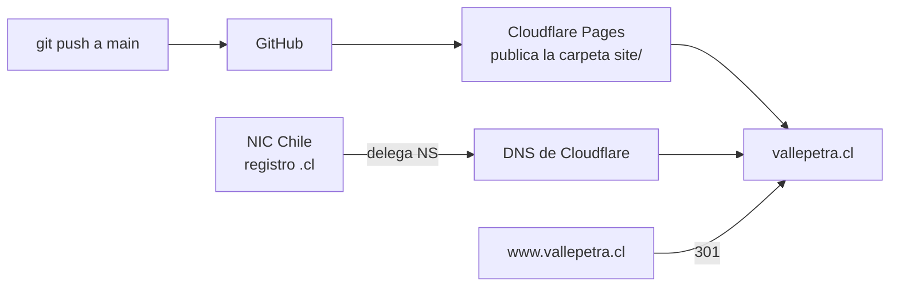

# Valle Petra

Sitio web e identidad de marca de **Valle Petra**, un refugio boutique familiar en Vicuña, Valle del Elqui (Chile). Lo diseñé, desplegué y aseguré de punta a punta: desde el logo hasta el DNS.

**En vivo:** [vallepetra.cl](https://vallepetra.cl) · Instagram [@vallepetraelqui](https://www.instagram.com/vallepetraelqui/)

> El sitio lleva `noindex` a propósito mientras se confirman precios y fotos finales: está publicado, pero los buscadores todavía no lo muestran.

## En 30 segundos

| | |
| --- | --- |
| **Despliegue** | Sitio estático en Cloudflare Pages con despliegue continuo desde GitHub. Dominio `.cl` propio inscrito en NIC Chile y delegado a Cloudflare, HTTPS forzado y una sola dirección oficial. |
| **Arquitectura** | HTML, CSS y JS sin frameworks ni dependencias de terceros en el navegador. Scripts propios en Python para generar el logo, el favicon y las imágenes de forma reproducible. |
| **Seguridad** | CSP estricta, HSTS, anti-clickjacking y política de permisos; fotos sin metadatos EXIF ni GPS (verificado por script); originales y secretos fuera del repositorio; aviso antifraude para huéspedes. |

## Despliegue



**Cómo funciona**

1. **Despliegue continuo.** Cada `push` a `main` publica la carpeta `site/` en Cloudflare Pages en unos 30 segundos. No hay paso de compilación: lo que está en el repositorio es exactamente lo que se sirve.
2. **Dominio propio.** `vallepetra.cl` está inscrito en NIC Chile, que delega la zona a los servidores de nombres de Cloudflare. El dominio raíz usa *CNAME flattening* para apuntar a Pages.
3. **Una sola dirección oficial.** Una regla de Cloudflare redirige `www` al dominio raíz con un 301 que conserva la ruta y los parámetros. HTTP se redirige a HTTPS.
4. **Verificación posterior.** Después de cada despliegue se comprueba con `curl` que el contenido nuevo esté en línea y que las cabeceras de seguridad sigan presentes.
5. **Lanzamiento por etapas.** El sitio se publicó primero con `noindex` en las páginas. No se bloquea con `robots.txt`, porque así el buscador no podría leer el `noindex`.

**Por qué Cloudflare Pages y no GitHub Pages:** los términos de GitHub Pages no permiten usarlo como hosting de un negocio comercial. Cloudflare Pages sí lo permite en su plan gratuito, con dominio propio, HTTPS automático y cabeceras configurables.

## Arquitectura y procesos

```
valle-petra/
├── site/      el sitio que se publica (HTML, CSS, JS, fuentes e imágenes)
│   └── _headers   cabeceras de seguridad que aplica Cloudflare
├── brand/     kit del logo (SVG, PNG, PDF/EPS), favicon y ficha técnica
├── design/    referencias de diseño y capturas (no se publica)
└── tools/     scripts que generan el logo, el favicon y las imágenes
```

**Decisiones técnicas**

- **Sin frameworks ni CDNs externos.** Tres archivos JS propios (`animaciones.js`, `galerias.js` y `tema.js`), las fuentes servidas desde el propio sitio y nada de scripts de terceros. Así la página es más rápida y su superficie de ataque, menor.
- **Separar las fuentes de lo publicado.** Las fotos originales (ProRAW/HEIC) **nunca entran al repositorio**. `tools/web/recursos.py` las convierte a WebP en sRGB, del tamaño justo para cada uso.
- **Recursos reproducibles.** El logo, el favicon (`.ico` armado en Python puro) y la imagen para compartir se generan con scripts. Cualquier cambio se repite con un solo comando ([tools/README.md](tools/README.md)).
- **Probar en local como en producción.** `tools/web/servidor.py` sirve `site/` aplicando las mismas cabeceras de `_headers` que Cloudflare, para detectar errores de CSP antes de publicar.
- **Accesibilidad y móvil.** Contraste mínimo de 4,5:1, controles de 44 px o más, modo claro y oscuro, y efectos de *hover* solo en dispositivos con mouse. Esto último corrigió un error en iOS que obligaba a tocar dos veces para abrir las galerías.
- **Decisiones documentadas.** Las reglas del proyecto y su porqué están en [site/README.md](site/README.md), en los comentarios del código y en los mensajes de commit.

## Seguridad

| Medida | Qué riesgo cubre | Dónde |
| --- | --- | --- |
| **Content-Security-Policy** estricta (`default-src 'self'`; solo el iframe del mapa de Google como excepción) | XSS: aunque alguien inyectara un `<script>`, el navegador no lo ejecutaría | [`site/_headers`](site/_headers) |
| **HSTS** (`max-age` de 1 año, sin `includeSubDomains` ni `preload`, por decisión) | Degradación a HTTP (*SSL stripping*) en redes públicas | `site/_headers` |
| `frame-ancestors 'none'` + `X-Frame-Options: DENY` | Clickjacking | `site/_headers` |
| `X-Content-Type-Options: nosniff` | Que un archivo se interprete con un tipo distinto al suyo | `site/_headers` |
| `Referrer-Policy` y `Permissions-Policy` (sin cámara, micrófono, ubicación, pagos ni USB) | Fuga de URLs a terceros y uso de APIs del navegador que la página no necesita | `site/_headers` |
| **Fotos sin EXIF, XMP ni GPS**, verificado con `webpinfo` después de convertir | Exponer la ubicación exacta y datos del dispositivo de quien tomó las fotos | [`tools/web/recursos.py`](tools/web/recursos.py) |
| Originales, credenciales y datos privados **fuera del repositorio** | Filtraciones en un repositorio público | `.gitignore` y proceso |
| **Aviso antifraude** en la página de reservas: solo canales oficiales | Fraude de reservas falsas, común en turismo | [`site/reservas.html`](site/reservas.html) |
| HTTPS forzado y una sola dirección canónica (`www` → raíz) | Mezcla de contenido, suplantación y confusión de dominios | Cloudflare |

**Verificarlo tú mismo**

```bash
curl -sI https://vallepetra.cl
```

**Próximos pasos de seguridad**

- Registros anti-suplantación de correo: SPF `-all`, DMARC `p=reject` y MX nulo, porque el dominio no envía correo.
- DNSSEC desde Cloudflare.
- Página `404.html` propia.
- Revisar la CSP cuando se integre un motor de reservas, que agrega terceros y datos de pago a la superficie de ataque.

## Trabajar en local

```bash
git clone https://github.com/Bogotor/valle-petra.git
cd valle-petra
python3 tools/web/servidor.py   # http://127.0.0.1:8766
```

Las fotos originales van en una carpeta hermana, fuera del repositorio. Los detalles están en [tools/README.md](tools/README.md).

## Herramientas

Python 3, Cloudflare Pages y DNS, NIC Chile, Git y GitHub. Usé Claude Code, un asistente de IA, como par de programación. Las decisiones de arquitectura, despliegue y seguridad, con sus alternativas, están documentadas en este README, en el código y en el historial de commits.

## Licencias

Las fuentes Fraunces y Figtree se distribuyen bajo la SIL Open Font License 1.1; sus licencias van junto a los archivos (`site/fonts/OFL-Fraunces.txt`, `site/fonts/OFL-Figtree.txt` y `tools/logo/fonts/OFL.txt`).
El logo, las imágenes y el contenido de Valle Petra pertenecen a sus dueños y no se licencian para reutilizarse.
